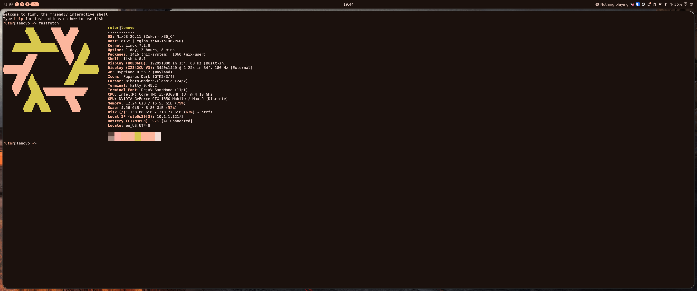

# nix-config

My personal NixOS configuration, managed with **Nix Flakes** and **Home Manager**.

## Hosts

Currently supported hosts:

* **lenovo** - Lenovo laptop configuration with Hyprland, Noctalia and Nvidia drivers.
* **surface** - Microsoft Surface configuration with GNOME and Surface-specific hardware support.


## Usage


## Installing on a fresh system

Boot the NixOS installer and open a terminal.

### 1. Enable flakes

```
export NIX_CONFIG="experimental-features = nix-command flakes"
```

### 2. Clone the repository

```
git clone https://github.com/rutra8002/nix-config
cd nix-config
```

### 3. Prepare the disk

Partition and mount your target disk at `/mnt`, with the EFI partition mounted at `/mnt/boot`.

For example:

```
mount /dev/sda2 /mnt
mkdir -p /mnt/boot
mount /dev/sda1 /mnt/boot
```

### 4. Generate hardware configuration

**Don't use the existing `hardware-configuration.nix`**

Generate one for the target machine:

#### surface
```
nixos-generate-config --root /mnt --show-hardware-config \
  > hosts/surface/hardware-configuration.nix
```

#### lenovo
```
nixos-generate-config --root /mnt --show-hardware-config \
  > hosts/lenovo/hardware-configuration.nix
```


### 5. Install the configuration

Install directly from the flake:

```
nixos-install --root /mnt --flake .#surface
```

Or:

```
nixos-install --root /mnt --flake .#lenovo
```


### 6. Reboot

After installation:

```
reboot
```

The configuration creates the `ruter` user. Log in as `ruter` after reboot.

## Applying a configuration after installation

Once the repository is cloned:

```
sudo nixos-rebuild switch --flake .#surface
```

or:

```
sudo nixos-rebuild switch --flake .#lenovo
```

## Gowin EDA on Lenovo

The `gowin-eda-education` flake package combines the Gowin EDA Education IDE
with Gowin's separate Linux Programmer archive. It exposes `gw_ide` and
`programmer`; the Lenovo Home Manager profile installs both, and the NixOS
configuration adds USB access rules for supported Gowin cables.

To run the IDE directly from the repository:

```
nix run .#gowin-eda-education
```

This package uses Gowin's Education edition and is subject to its terms of use.
---

## Showcase

[video](docs/showcase.mp4)
